# IDA AI Malware Analyst

## The Public User Guide

*Turn an unfamiliar binary into a structured investigation. Understand the behaviour, follow the evidence, and keep every important decision in the analyst's hands.*

**Document edition:** Public Guide  
**Plugin version covered:** 1.4.0  
**Environment:** IDA Pro 9.x · IDAPython · Python 3.9+ · Hex-Rays optional  
**AI connectivity:** Gemini, Claude, or a compatible provider configured by the user

> **A note about this edition**  
> This is a user guide, not a developer handbook. It explains what the plugin helps an analyst accomplish, how to use its visible capabilities, how to interpret its results, and where human verification remains essential. It intentionally does not publish private prompts, internal tool definitions, detection rules, scoring weights, algorithm implementations, or internal software architecture.

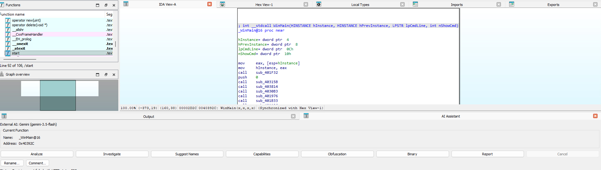

---

## Start here

Reverse engineering is rarely difficult because an analyst cannot understand assembly. It is difficult because a real sample can contain hundreds or thousands of functions, layers of indirection, misleading names, encoded data, compiler-generated routines, and behaviour spread across multiple execution paths.

IDA AI Malware Analyst is designed to make that work more focused. It brings AI-assisted interpretation and investigation support into the IDA Pro workspace, where the analyst can move directly between a finding and the code that supports it.

The plugin is not an automatic malware verdict machine. It is an analysis assistant: it helps you decide where to look, understand what a function appears to do, connect related behaviour, investigate suspicious data, organise your findings, and prepare a report.

### What you can do with it

- **Find a starting point:** quickly review a binary and prioritise functions that deserve attention.
- **Understand a function:** get a readable explanation supported by addresses and code references.
- **Follow behaviour across functions:** investigate callers, callees, strings, and related functionality.
- **Explore obfuscation:** examine suspicious decoding, hidden strings, API resolution, and transformed data.
- **Describe capabilities:** organise behavioural evidence into analyst-friendly capability findings.
- **Clean up your IDB safely:** review proposed names and comments before deciding whether to apply them.
- **Preserve investigation context:** revisit previous results and generate a structured Markdown report.

## Contents

### Part I — The analyst's workflow
1. [Why the plugin exists](#1-why-the-plugin-exists)
2. [The principles behind the user experience](#2-the-principles-behind-the-user-experience)
3. [The investigation at a glance](#3-the-investigation-at-a-glance)
4. [Data handling and external AI](#4-data-handling-and-external-ai)

### Part II — Your workspace, capability by capability
5. [The AI Assistant panel](#5-the-ai-assistant-panel)
6. [Analyze and Findings](#6-analyze-and-findings)
7. [Binary and Triage](#7-binary-and-triage)
8. [Investigate](#8-investigate)
9. [Capabilities](#9-capabilities)
10. [Obfuscation](#10-obfuscation)
11. [Suggest Names, Rename, Comment and Proposed Changes](#11-suggest-names-rename-comment-and-proposed-changes)
12. [History](#12-history)
13. [Ask AI](#13-ask-ai)
14. [Report](#14-report)
15. [Settings and provider selection](#15-settings-and-provider-selection)

### Part III — Apply it to real analysis
16. [A complete investigation, from first look to report](#16-a-complete-investigation-from-first-look-to-report)
17. [Malware and software playbooks](#17-malware-and-software-playbooks)
18. [Where the plugin saves analyst time](#18-where-the-plugin-saves-analyst-time)
19. [How to read results responsibly](#19-how-to-read-results-responsibly)

### Part IV — Getting started and reference
20. [Installation and first run](#20-installation-and-first-run)
21. [Security, privacy and safe use](#21-security-privacy-and-safe-use)
22. [Limitations and troubleshooting](#22-limitations-and-troubleshooting)
23. [Glossary](#23-glossary)

---

# Part I — The analyst's workflow

## 1. Why the plugin exists

Imagine opening an unfamiliar Windows executable in IDA. The Functions window is full of automatically generated names. Some routines belong to the compiler or runtime library. Others perform the actual work of the program. A few may decrypt a configuration, resolve hidden imports, collect information, contact a remote server, install another component, or modify files.

The analyst's first challenge is not simply to read code. It is to work out **which code deserves attention first**.

The next challenge is to keep the investigation coherent. A downloader may receive a payload that is decoded by another function and executed by a third. A stealer may enumerate browser data in one routine, package it in another, and send it through a network function elsewhere. A ransomware sample may separate key generation, file discovery, encryption, and recovery prevention across many functions.

Traditional reverse engineering tools remain essential, but the repetitive work around them can consume significant time:

- separating likely application logic from routine compiler-generated code;
- translating unfamiliar function bodies into concise behavioural descriptions;
- following relationships between functions;
- identifying strings and data that deserve a closer look;
- documenting what has been verified and what remains uncertain;
- keeping IDB names and comments consistent with the evidence;
- turning scattered notes into a report.

IDA AI Malware Analyst was created to assist with those tasks without removing the analyst from the decision-making process.

### The purpose in one sentence

**The plugin helps an analyst move from an unfamiliar binary to an evidence-led understanding of its behaviour, with less repetitive investigation and a clearer record of the work.**

It is intended for malware researchers, reverse engineers, incident responders, threat researchers, and security analysts who already use IDA Pro as part of their workflow.

## 2. The principles behind the user experience

The plugin is built around four practical principles. These are the promises the user experience should make clear.

### IDA remains the place to verify

The disassembly, pseudocode, addresses, cross-references, and database state shown by IDA are the analyst's reference point. An AI explanation is a guide to the code, not a replacement for inspecting it.

### AI helps interpret; the analyst decides

The assistant can explain possible behaviour, connect related observations, suggest names, and highlight uncertainties. The analyst decides whether those interpretations fit the sample and whether a suggested database change is appropriate.

### Results should be useful, not just impressive

A readable summary is helpful, but it is more useful when the analyst can move from the explanation to a relevant address, inspect the supporting code, and decide what to investigate next.

### Important changes remain under analyst control

Suggested function names, variable names, global names, comments, and types are presented for review. They are not a substitute for analyst approval. The user can reject suggestions, approve appropriate changes, and review previous operations.

## 3. The investigation at a glance

The plugin is most effective when used as part of a repeatable investigation. Start broad, narrow your attention, examine the strongest leads, and record what you establish.

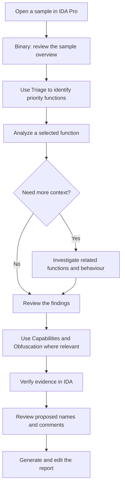

### What happens at each stage

| Stage | Your goal | What the plugin gives you |
|---|---|---|
| First look | Understand the broad shape of the binary | An overview, triage signals, and suggested places to begin |
| Function analysis | Explain one routine | A structured summary, behaviour observations, evidence references, and uncertainties |
| Wider investigation | Understand how routines connect | Related-function context, an investigation narrative, indicators, and an activity trace |
| Capability review | Describe what the code can do | Behavioural capability findings and relevant technique context |
| Obfuscation review | Understand hidden or transformed data | Findings and decoded artefacts where supported |
| IDB organisation | Make analysis easier to revisit | Reviewable naming and comment proposals |
| Reporting | Preserve the investigation | A Markdown report built from the collected analysis record |

## 4. Data handling and external AI

Malware analysts should understand what information is shared before enabling any cloud-backed analysis tool.

The plugin is designed around an explicit user action. It does not need to send analysis context simply because IDA is open. When you invoke an AI-backed capability, the plugin prepares relevant information for that action and sends it to the provider configured in Settings.

### What may be shared during an analysis action

Depending on the capability you invoke, the information can include a bounded description of the selected function, such as its name and address, disassembly, available pseudocode, related function references, imports, strings, or other analysis context. A binary-wide action may share a compact overview rather than every function body. An investigation may request additional context as it follows a lead.

### What the guide's current source says is not uploaded

The plugin documentation states that the sample file itself and raw sample bytes are not uploaded as part of these analysis requests. Byte-level operations used for supported deobfuscation are performed locally against the IDB data. The documentation also states that the plugin does not perform background analysis or telemetry while idle.

### Choose the provider with care

Your configured provider or compatible endpoint is the destination for the analysis context. Some compatible services act as relays to another model provider. In that case, the service operator may process the context before forwarding it. Review the applicable privacy and retention terms before sending sensitive samples or proprietary code to any external service.

For confidential investigations, use an organisation-approved provider or a suitably configured local endpoint. Follow your employer's data-handling rules and any restrictions attached to the sample.

> **Important:** “The sample file is not uploaded” does not mean “no sample-related information leaves the machine.” Function context, strings, names, addresses, and analysis summaries can still be shared when you invoke an external AI action. Treat those details as potentially sensitive.

### The user-visible request and response journey

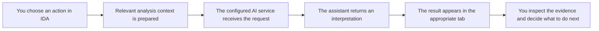

This is the experience from the analyst's perspective. It intentionally describes the service boundary without exposing private implementation details.

---

# Part II — Your workspace, capability by capability

## 5. The AI Assistant panel

The AI Assistant panel is designed to sit alongside the normal IDA workspace. You can keep your disassembly, pseudocode, Functions window, and the assistant visible at the same time.

The panel provides a common place to launch analysis actions and review their results. The exact appearance can vary with the IDA version, provider, and plugin release.

### The main actions

| Action | When to use it | What to expect |
|---|---|---|
| **Analyze** | You want to understand the function under the cursor | A structured function explanation in Findings |
| **Investigate** | You need the assistant to examine related code and connect observations | A broader investigation with supporting context and a trace |
| **Suggest Names** | The function and its local variables are difficult to understand | Suggested names presented for review |
| **Capabilities** | You want to understand the behaviour or role of a function | Capability-oriented findings |
| **Obfuscation** | The function or binary appears to hide strings, imports, or logic | Obfuscation findings and supported decoded artefacts |
| **Binary** | You are starting a new sample or need a wider overview | Binary triage and prioritised analysis guidance |
| **Report** | You want to preserve the current investigation | A Markdown report |
| **Cancel** | An operation is taking longer than expected or is no longer needed | Requests the active operation to stop |
| **Rename…** | You have decided on a specific name yourself | A rename proposal for review |
| **Comment…** | You want to add an analyst note to the IDB | A comment proposal for review |
| **Settings** | You need to select or configure an AI provider | Provider, model, connection, and analysis preferences |

The same or related actions may also be available through IDA menus or context menus, depending on the current plugin build.

### The result tabs

| Tab | Its purpose |
|---|---|
| **Findings** | Read the latest analysis results and evidence |
| **Proposed Changes** | Review suggested IDB changes before applying them |
| **Investigation** | Follow a broader investigation and inspect its activity |
| **Triage** | Review the binary overview, verdict context, call flows, and analysis path |
| **History** | Revisit recorded actions and database-change activity |
| **Ask AI** | Ask follow-up questions about the current function |

Think of the action row as the set of questions you can ask, and the tabs as the places where you review the answers and the work produced.

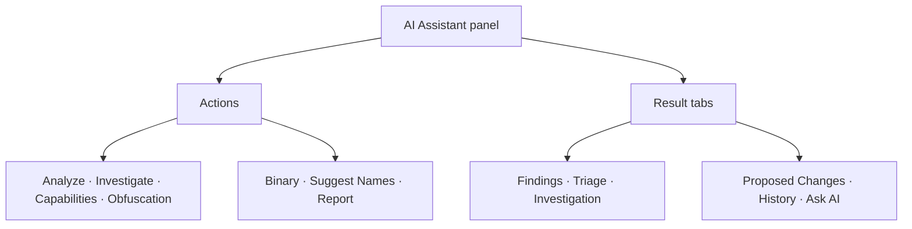

## 6. Analyze and Findings

**Use Analyze when you want a focused explanation of one function.**

Select a function in IDA, place the cursor inside it, and click **Analyze**. The assistant returns a structured interpretation intended to help you understand the function without losing the connection to the original code.

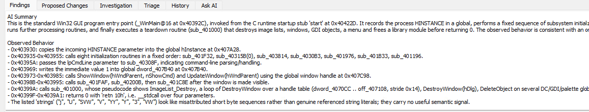

### How to read a finding

A useful analysis is more than a paragraph. Review its components in this order:

1. **Evidence:** inspect the referenced addresses and the code at those locations.
2. **Observed behaviour:** identify what the code demonstrably does.
3. **Inference:** understand the interpretation drawn from one or more observations.
4. **Hypothesis:** note possible explanations that still need confirmation.
5. **Uncertainties:** identify missing context and the next places worth investigating.
6. **Suggested name:** consider whether the proposed label accurately describes the function.

### Example: a configuration decryptor

Suppose a function references cryptographic APIs, processes a data buffer, and passes the resulting content to another routine. The assistant may describe the function as a possible configuration-decryption routine and point you to the relevant code locations.

The analyst should still answer the important questions:

- Is the cryptographic operation actually a decryption step?
- Where does the key or password come from?
- Is the buffer embedded in the binary or received from another function?
- What consumes the resulting data?
- Does the decrypted content contain configuration, a payload, or something else?

The value of Analyze is that it gives you a structured starting interpretation and highlights the code to verify. It does not remove the need to understand the routine.

### When Analyze is especially useful

- A function has an autogenerated name and an unclear purpose.
- Several API calls appear together and you want a behavioural explanation.
- A function contains a complicated loop or multiple branches.
- You need to understand the role of a caller or callee before following a larger path.
- You want a quick, address-linked note before moving to another function.

## 7. Binary and Triage

**Use Binary first when you open an unfamiliar sample.**

The purpose of triage is to help answer three questions:

1. What kind of executable am I looking at?
2. Which parts deserve attention first?
3. What is a sensible order for the investigation?

The Triage tab presents a binary-level view and a prioritised analysis path. It can bring together signals such as imports, strings, function relationships, section characteristics, packing indicators, and suspicious behavioural combinations.

### Understanding the triage result

The result is intended to be read as an evidence-led prioritisation aid, not a definitive malware verdict. Review the reasons behind a score or label rather than relying on the label alone.

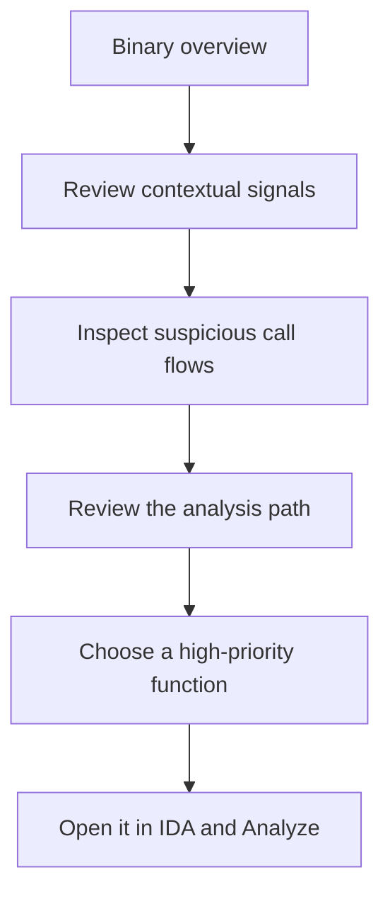

### What the analysis path means

Instead of giving you an undifferentiated list of hundreds of functions, the path is intended to highlight functions that may be significant to the sample's behaviour. It can help you decide whether to begin with a decryptor, resolver, network routine, file operation, process manipulation function, or another point of interest.

Double-click or navigate to the suggested function and inspect it in IDA. If a function you care about is missing from the prioritised path, analyse it directly. Prioritisation is a convenience, not a guarantee that every relevant function has been selected.

### Why call flows matter

A suspicious API call is more informative when you understand how execution reaches it. A call-flow view helps show whether a function is reached from the program's entry path, from another suspicious routine, or through a path that deserves additional manual investigation.

### Use Triage to avoid two common mistakes

- **Reading everything in the order IDA lists it.** Start with the strongest leads, then expand as the evidence requires.
- **Treating one signal as proof.** A networking API, cryptographic function, high-entropy section, or persistence operation can occur in legitimate software too. Interpret combinations and context.

## 8. Investigate

**Use Investigate when one function is not enough to explain the behaviour.**

Analyze is best for a focused question about the function under the cursor. Investigate is designed for a broader question: how does this function relate to the rest of the program?

For example, a suspicious routine may call a decoder, receive data from a network function, and pass a buffer to a process-creation routine. Understanding only one of those functions leaves the behaviour incomplete.

### What you see in the Investigation tab

The investigation experience can present several useful views:

- **Behaviour narrative:** a readable account of the activity established during the investigation.
- **Attack-chain view:** a staged interpretation of how the observed behaviour may fit together.
- **Analysis path:** functions that are useful to inspect next.
- **Indicators:** relevant strings and artefacts identified during the review.
- **Activity trace:** a record of the investigative actions and evidence gathered.

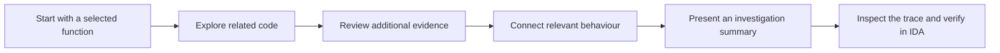

### Example: following a loader

A loader may have a function that decrypts a configuration, another that resolves APIs, and a third that prepares a process for execution. Investigate can help connect these pieces into a coherent narrative.

The analyst should verify the transitions:

- Does the configuration really supply the next-stage information?
- Does the resolver produce the APIs used by the execution routine?
- Where does the payload originate?
- Is the target process selected dynamically?
- Is the execution path actually reachable?

### When to use Investigate

Use it when the important behaviour crosses function boundaries, when you need to understand an orchestration routine, or when a single-function summary leaves important questions unanswered.

For a very large or complex sample, review the scope and output carefully. Broader investigations are useful, but they still depend on the quality of the decompilation, the context available, and the leads selected for review.

## 9. Capabilities

**Use Capabilities when you need to describe what the code can do.**

A capability-oriented view helps translate low-level code into behaviour that another analyst, incident responder, or report reader can understand.

Depending on the function and available evidence, findings may relate to areas such as:

- process and thread manipulation;
- execution and payload loading;
- persistence;
- networking and command-and-control communication;
- cryptographic operations;
- discovery and system inspection;
- configuration handling;
- anti-analysis behaviour;
- dynamic API resolution.

### What makes a capability finding useful?

A good capability finding should tell the reader:

- what behaviour is being described;
- which function or code location supports it;
- which API references, strings, or other observations are relevant;
- whether the statement is directly observed or an interpretation;
- what remains uncertain.

Where relevant, the plugin can provide MITRE ATT&CK technique context. Treat a technique mapping as an aid to classification and reporting, not as proof that the entire technique was successfully carried out.

### Example: process injection

A function that allocates memory in another process, writes data into that memory, and starts execution there may support an injection-related capability finding. To establish the full behaviour, inspect the target-process selection, memory permissions, payload source, error handling, and execution path.

### Why this helps

Capability analysis reduces the amount of translation an analyst has to do between assembly-level observations and a useful behavioural description. It is especially valuable when preparing a report, comparing samples, or explaining a finding to someone who did not perform the reverse engineering.

## 10. Obfuscation

**Use Obfuscation when the sample appears to conceal strings, imports, data, or program logic.**

Obfuscation is a common reason that static analysis initially reveals very little. A sample may hide URLs, API names, configuration values, file paths, or payload content until runtime.

The Obfuscation experience is intended to help identify suspicious patterns and, where a supported transformation can be established, make the resulting data easier to inspect.

### Areas it can help investigate

- **Hidden strings:** strings constructed or transformed before use.
- **API resolution:** APIs identified indirectly rather than referenced by their normal names.
- **Encoded configuration:** data that must be decoded before the program can use it.
- **Compressed or transformed data:** buffers that may contain configuration or another executable component.
- **Control-flow complexity:** patterns that make the program harder to follow.
- **Packing and protection clues:** binary characteristics that suggest additional unpacking or runtime analysis may be necessary.

### Example: recovering a hidden network endpoint

A function may process an apparently random data buffer and later pass the result to a networking routine. The analyst can use Obfuscation to investigate the transformation and inspect any recovered text or data preview.

The important verification questions are:

- Does the result make sense in the context of the transformation?
- Does the decoded output match the bytes and data flow visible in IDA?
- Is the recovered string actually referenced or used by the program?
- Does a caller provide the key, seed, table, or other required input?

A readable string is not automatically an active indicator. Confirm that the program uses it.

### Understand the result

A successful transformation can expose useful artefacts. An unsuccessful or inconclusive result is also informative: it may mean the transformation is unsupported, the input is incomplete, the sample uses a different scheme, or the relevant data is created only at runtime.

When static analysis is insufficient, continue with the appropriate dynamic-analysis or memory-analysis workflow in your lab.

## 11. Suggest Names, Rename, Comment and Proposed Changes

**Use these features to make the IDB easier to understand without giving up control of it.**

Names such as `sub_4012A0`, `v7`, or `unk_41D3C0` are useful placeholders, but they do not communicate the role of a routine or data item. Descriptive names and comments make an investigation easier to revisit and share.

### Suggest Names

Suggest Names asks the assistant to recommend clearer names for the selected function and relevant variables or referenced globals. Suggestions should describe observed behaviour rather than assume malicious intent.

For example:

| Generic label | Possible descriptive label |
|---|---|
| `sub_4012A0` | `decrypt_configuration` |
| `v7` | `decrypted_buffer` |
| `unk_41D3C0` | `embedded_config_blob` |

These are examples, not universal naming rules. Choose names that accurately reflect what you have verified.

### Rename… and Comment…

Use Rename… when you already know what a function or symbol should be called. Use Comment… to record a concise analyst observation at a relevant location.

### Proposed Changes

Suggested modifications are presented for review. Inspect the target, old value, proposed value, and reason before approving a change. Reject anything that is unclear, too broad, or not supported by the evidence.

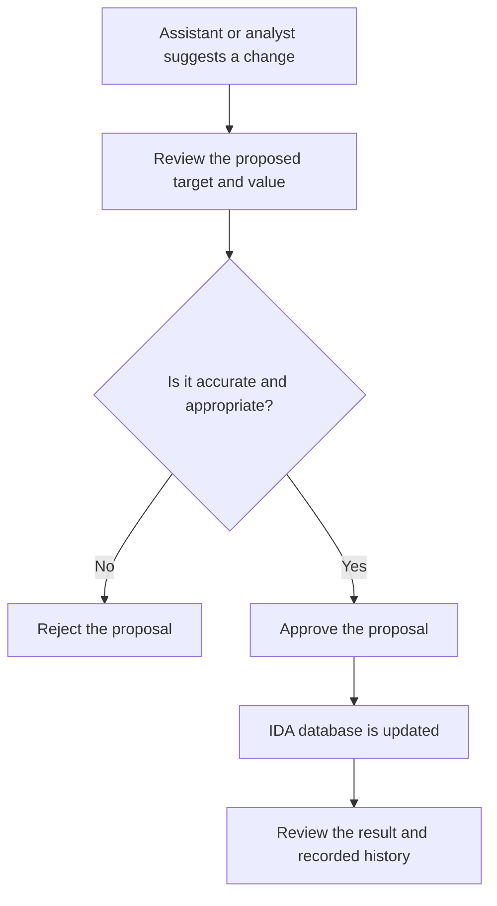

The key user benefit is simple: the assistant can help with the repetitive work of organising an IDB, while the analyst remains responsible for what is actually changed.

## 12. History

History helps you return to work you have already performed. It is useful when an investigation spans many functions or when you want to revisit why a particular name or comment was added.

Use History to review:

- previous analysis actions;
- recorded findings and summaries;
- proposed or completed database changes where available;
- operations that were reversed;
- the context needed to understand earlier decisions.

History is especially useful before generating a report or handing an investigation to another analyst. It should be treated as an aid to continuity, not as a replacement for preserving the original sample, IDB, and case evidence according to your organisation's procedures.

## 13. Ask AI

Ask AI is for focused follow-up questions about the function currently under review.

Examples:

- “What is the likely purpose of this loop?”
- “Which argument appears to control the buffer length?”
- “What evidence suggests that this function handles a configuration?”
- “What should I inspect next to confirm this interpretation?”
- “Explain the branch around this address in plain language.”

Ask one question at a time when possible. Include an address or a specific code area when the question concerns a particular operation. Review the answer against the disassembly and use a broader Investigate action if the question requires context from multiple functions.

## 14. Report

**Use Report to turn the collected analysis into a document you can review, edit, and share.**

The plugin generates a Markdown report based on the investigation record. Depending on the material collected, it can include:

- an executive summary;
- sample overview and triage context;
- verdict and supporting reasons;
- packing and protection observations;
- attack-chain narrative;
- guided analysis path;
- indicators of compromise;
- analysed functions and their evidence;
- capability findings;
- obfuscation findings and recovered artefacts;
- applied changes and pending proposals;
- investigation activity and uncertainties;
- token-usage information and methodology notes.

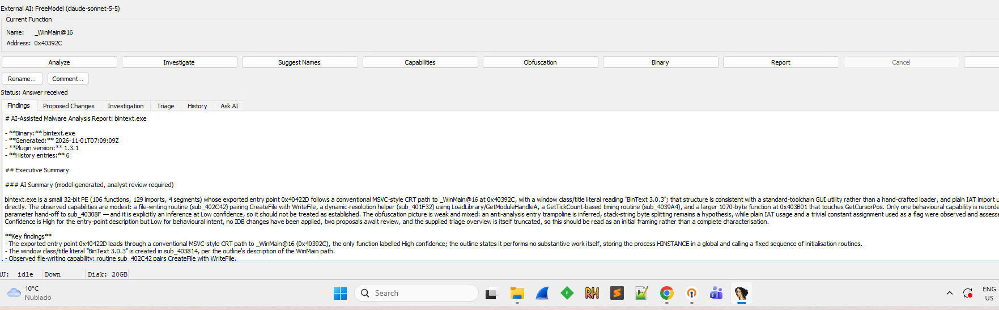

### Treat the report as a draft for analyst review

The report is designed to save time on structure and repeated note-taking. It does not replace the analyst's final review. Check the sample identity, addresses, evidence, confidence, classification, and any model-generated executive summary before publishing or sending the report.

A useful report should distinguish what was observed, what was inferred, and what still needs confirmation. Keep the original analysis artefacts and case references according to your normal evidence-handling process.

## 15. Settings and provider selection

Settings is where you choose how the assistant connects to an AI service and adjust the options available in your build.

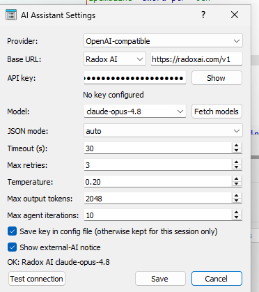

The visible settings may include:

- provider type;
- a compatible service or base URL;
- API key entry and visibility control;
- model selection and model-list retrieval;
- response-format preference;
- request timeout and retry preferences;
- output length and temperature;
- investigation limits;
- budget controls for broader investigations;
- connection testing and saving.

### Choosing a provider

Choose a provider approved for the type of sample and data you are analysing. A model that is faster or cheaper is not necessarily better for every reverse-engineering task. Compare the quality of its explanations, its reliability with structured findings, latency, cost, and the provider's data-handling terms.

### A practical setup checklist

1. Select the provider or compatible endpoint you are authorised to use.
2. Enter the API key in the settings dialog.
3. Retrieve the available model list where supported.
4. Select a model suitable for your analysis workload.
5. Test the connection.
6. Save the settings and check the provider notice shown in the panel.

The screenshots in this guide are examples from a captured plugin build. Names, presets, available models, and settings may differ by release and provider.

---

# Part III — Apply it to real analysis

## 16. A complete investigation, from first look to report

This walkthrough demonstrates how the capabilities can be combined. The sample is illustrative: it represents a hypothetical loader with an encrypted configuration, hidden API references, network communication, and a second-stage execution path.

### Step 1 — Open the sample and review Binary

Let IDA complete its normal analysis. Open the AI Assistant panel and select **Binary**.

Read the overview and triage information. Identify whether the file has indicators of packing, import hiding, network activity, process manipulation, persistence, or suspicious file operations.

Do not settle on a final classification yet. Choose the strongest leads for closer inspection.

### Step 2 — Start with the most informative function

Open the highest-priority function and click **Analyze**. Review the evidence and determine whether it appears to be a decoder, configuration parser, API resolver, network routine, or something else.

Follow the addresses back into the disassembly. Record what is directly visible and what is still a hypothesis.

### Step 3 — Investigate related behaviour

Click **Investigate** when the function's purpose depends on other routines. Look for the function that supplies its input and the function that consumes its output.

For a loader, this may connect configuration handling, API resolution, payload preparation, and execution. Review the investigation trace and verify the important transitions in IDA.

### Step 4 — Examine obfuscation

If strings or data appear concealed, open **Obfuscation**. Review the suggested interpretation and any recovered artefacts. Confirm the recovered content against the relevant buffer and its use.

If the output identifies a URL or file path, establish whether the program actually references it in an active execution path.

### Step 5 — Review capabilities

Use **Capabilities** on the functions that perform significant operations. Record the evidence for networking, execution, persistence, discovery, process manipulation, or other behaviour that is relevant to the sample.

### Step 6 — Improve the IDB

Use **Suggest Names** to organise the functions and data you now understand. Review every proposed change. Approve only names and comments that reflect confirmed behaviour.

### Step 7 — Ask the remaining questions

Use **Ask AI** for focused gaps. For example, ask where the payload buffer comes from or which branch controls execution. If the missing answer requires other functions, return to Investigate.

### Step 8 — Generate and review the report

Click **Report**. Review the report's summary, evidence, indicators, uncertainties, and classification. Edit the wording for your audience and make sure the final conclusion matches your own analysis.

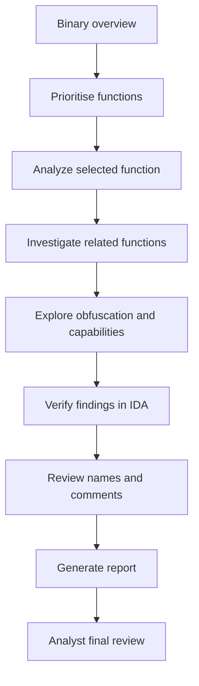

The objective is not to make every decision automatically. It is to shorten the distance between the first useful observation and a coherent, evidence-backed conclusion.

## 17. Malware and software playbooks

Different sample types require different questions. The following playbooks show where the plugin can help and what an analyst should try to establish. These are investigation guides, not fixed detection recipes or guaranteed classifications.

### 17.1 Generic malicious loader

**Typical questions**

- Does the sample unpack or decode another component?
- Does it resolve APIs dynamically?
- Where does the next-stage payload originate?
- Does it inject into another process or execute a child process?
- How does it communicate with external infrastructure?

**Suggested workflow**

Start with **Binary** and review packing, import visibility, and suspicious call flows. Use **Obfuscation** on functions that appear to resolve APIs or decode configuration. Use **Analyze** on the functions responsible for payload preparation and execution. Use **Investigate** to connect those functions into a larger behaviour narrative.

**What to document**

Payload source, decoding or loading behaviour, execution method, target process if applicable, network indicators, persistence, and the evidence supporting each conclusion.

### 17.2 Information stealer

**Typical questions**

- Which user data or application profiles are accessed?
- Does the sample interact with browser databases, cookies, tokens, wallets, or messaging applications?
- Is protected data accessed through operating-system facilities or application-specific files?
- How is collected data staged, compressed, encrypted, or transmitted?

**Suggested workflow**

Use **Capabilities** on collection-related functions. Use **Obfuscation** to inspect concealed file paths, application names, or network configuration. Use **Investigate** to connect collection, staging, and exfiltration. Review the **Indicators** view and report for relevant paths, domains, and other artefacts.

**What to document**

The exact data sources accessed, the collection method, staging location, archive or encryption behaviour, transmission method, and any limitations in what could be confirmed statically.

### 17.3 Ransomware

**Typical questions**

- How does the program discover files and drives?
- Which files or directories are excluded?
- Which cryptographic operations are used, and how is key material handled?
- Does it interfere with backups or recovery mechanisms?
- How are files renamed and how is the ransom message created?

**Suggested workflow**

Use **Binary** to identify likely cryptographic, discovery, and impact-related functions. Use **Analyze** on key-management and file-processing routines. Use **Capabilities** to organise file discovery, encryption, and recovery-inhibition behaviour. Use **Obfuscation** if extension lists, exclusions, or ransom-related configuration are hidden.

**What to document**

File-selection behaviour, encryption and key-management observations, excluded paths, recovery impact, ransom-note artefacts, and whether the sample's destructive behaviour was established or only inferred.

### 17.4 Dropper

**Typical questions**

- Does the executable contain an embedded component?
- How is the component extracted or reconstructed?
- Where is the output written?
- Is the dropped file executed, registered, or handed to another process?

**Suggested workflow**

Use **Binary** to review resources, overlays, and suspicious data sections. Use **Obfuscation** on the routine that transforms or writes the embedded content. Use **Analyze** on file-writing and launch routines. Review the call flow to understand the order of extraction and execution.

**What to document**

The source and format of the embedded object, the transformation applied, the output path, the execution method, and whether the dropped component was recovered and independently analysed.

### 17.5 Downloader or loader

**Typical questions**

- Which remote locations are contacted?
- How is the response handled?
- Is downloaded content saved to disk or processed in memory?
- What happens after the response is received?
- Are there retry, delay, or environment-check behaviours?

**Suggested workflow**

Use **Indicators** to review network-related strings and artefacts. Use **Analyze** on the communication routine and response-handling functions. Use **Capabilities** to describe the subsequent execution behaviour. Use **Investigate** when the download and execution logic are spread across several functions.

**What to document**

Endpoints, request context, response handling, payload location, execution method, and evidence linking the network response to the next stage.

### 17.6 Legitimate software

The plugin is also useful when the correct outcome is benign or when suspicious-looking behaviour has a legitimate explanation.

**Typical questions**

- Is the sample primarily a standard GUI, installer, updater, or business application?
- Are network or persistence operations consistent with the product's purpose?
- Are suspicious functions actually library or framework routines?
- Is the apparent obfuscation part of normal packaging or protection?

**Suggested workflow**

Start with **Binary** and examine the mitigating context as carefully as suspicious signals. Use **Analyze** on the functions that triggered interest. Use **Investigate** only where the behaviour needs more context. Record why the observed operations are consistent with the program's intended purpose.

**What to document**

Product context, expected functionality, relevant file and registry operations, network behaviour, code-signing or version information where independently available, and evidence supporting a benign conclusion.

### 17.7 PUP, adware, or bundler

Potentially unwanted programs can perform unwanted or intrusive activity without behaving like a conventional destructive malware sample.

**Typical questions**

- Does the program change browser settings or search providers?
- Does it install extensions, services, scheduled tasks, or startup entries?
- Does it bundle additional applications?
- Does it present misleading consent or installation options?
- What telemetry, affiliate, or advertising infrastructure does it contact?

**Suggested workflow**

Use **Binary** to identify persistence and networking signals. Use **Capabilities** on configuration and installation routines. Use **Obfuscation** for concealed URLs or configuration. Use **Analyze** on browser-setting, service, and installer functions.

**What to document**

The exact system changes, installation choices, persistence, network destinations, bundled components, and the reason the software is considered unwanted. Avoid automatically equating PUP behaviour with a malware verdict.

### 17.8 Hacktool and dual-use software

Tools used by administrators, penetration testers, and security researchers may expose capabilities that are also used by malware. A capability alone does not establish malicious intent.

**Typical questions**

- What functionality does the tool expose to its operator?
- Are there command-line options, help strings, or interactive modes?
- Does it perform credential access, token manipulation, process injection, scanning, or remote execution?
- Is it a known administrative or security tool, or a customised implant?

**Suggested workflow**

Use **Capabilities** to understand the technique inventory. Use **Analyze** on the entry point and command-line handling. Use **Investigate** to establish which operations are reachable and under what conditions. Review help text and usage strings as well as the implementation.

**What to document**

The tool's capabilities, operator controls, execution conditions, provenance where known, and the distinction between dual-use functionality and evidence of malicious deployment.

### A quick family-to-feature guide

| Sample type | Start with | Then consider | Key analyst objective |
|---|---|---|---|
| Generic malicious loader | Binary, Triage | Obfuscation, Investigate | Connect decoding, resolution, and execution |
| Information stealer | Capabilities | Obfuscation, Investigate | Establish what data is collected and exfiltrated |
| Ransomware | Binary, Analyze | Capabilities, Obfuscation | Understand file discovery, key handling, and impact |
| Dropper | Binary | Obfuscation, Analyze | Recover and trace the dropped component |
| Downloader | Indicators, Analyze | Capabilities, Investigate | Link network retrieval to subsequent execution |
| Legitimate software | Binary, Findings | Analyze, Report | Explain benign functionality and mitigating context |
| PUP / adware | Binary, Capabilities | Analyze, Indicators | Document unwanted changes and distribution behaviour |
| Hacktool / dual-use | Capabilities | Analyze, Investigate | Describe capabilities without assuming intent |

## 18. Where the plugin saves analyst time

The plugin is intended to reduce repetitive analysis overhead. It does not make every reverse-engineering problem easy, and it cannot guarantee a fixed time saving on every binary. The benefit depends on sample complexity, model quality, the amount of useful context in IDA, and the analyst's familiarity with the behaviour being examined.

| Repetitive task | How the plugin helps | What the analyst still does |
|---|---|---|
| Finding interesting functions | Provides a prioritised starting path | Decide which functions matter and inspect missed leads |
| Understanding an unfamiliar routine | Produces a structured explanation | Verify the code and correct inaccurate interpretations |
| Connecting functions | Helps organise relationships into an investigation narrative | Confirm the actual data and execution flow |
| Reviewing hidden data | Helps investigate supported transformations and artefacts | Validate recovered content and runtime use |
| Describing capabilities | Presents behavioural findings in report-friendly language | Confirm the technique and its context |
| Naming functions and data | Suggests descriptive labels | Approve or reject every meaningful change |
| Preparing a report | Builds a structured Markdown draft | Review evidence, classification, and final wording |

### The most valuable time saving is often focus

Instead of spending the first part of every investigation moving randomly through autogenerated functions, the analyst can begin with a suggested path. Instead of repeatedly translating low-level details into notes, the analyst gets a structured starting explanation. Instead of reconstructing the whole session from memory, the analyst can review the investigation record and report draft.

That is the intended productivity improvement: **less repetitive organisation, more time spent verifying the behaviour that matters.**

## 19. How to read results responsibly

An AI-assisted result is useful only when the analyst can judge whether it is correct.

### Evidence before summary

Start with the addresses and code references. Confirm that the cited operation exists and that it supports the described behaviour.

### Observed behaviour is not the same as intent

A function may call a sensitive API without using it maliciously. A program may collect system information for a legitimate inventory function. A network routine may belong to an updater. Describe what the code does before deciding why it does it.

### Keep inference and hypothesis separate

An inference is an interpretation supported by evidence. A hypothesis is a possible explanation that needs more work. Do not convert either into a confirmed fact without checking it.

### Treat a verdict as triage guidance

A score or label can help prioritise the review, but it is not a malware probability and does not replace full analysis, reputation research, sandboxing, memory inspection, or organisational classification policy.

### Verify recovered artefacts

A decoded URL, path, or configuration value matters most when the code actually uses it. Check the source buffer, transformation, destination, and execution path.

### Review names before applying them

A plausible-sounding name can mislead everyone who later reads the IDB. Prefer a conservative name over a confident but unverified one.

---

# Part IV — Getting started and reference

## 20. Installation and first run

The steps below reflect the plugin's current public installation guidance. Follow the release package's own instructions if they differ.

1. Download the plugin release package.
2. Copy the plugin entry file and its accompanying package directory into the IDA plugins directory.
3. Start IDA Pro and open a sample.
4. Confirm that the plugin has loaded in the IDA Output window.
5. Open the AI Assistant panel from IDA's view/subview menu.
6. Open **Settings**, select an approved provider, configure the model and credentials, and test the connection.
7. Select a function and run **Analyze** to perform your first focused analysis.

### Common plugin directory locations

- **Windows:** `%APPDATA%\Hex-Rays\IDA Pro\plugins`
- **Linux:** `~/.idapro/plugins`
- **macOS:** `~/.idapro/plugins`

The plugin requires IDA Pro 9.x and IDAPython on Python 3.9 or later, according to the current project documentation. Hex-Rays is optional. Without it, assembly-based analysis remains available, while pseudocode-dependent capabilities and local-variable renaming may be unavailable.

## 21. Security, privacy and safe use

Malware analysis involves hostile input. A sample may contain strings or data designed to influence automated systems, and analysis context may contain proprietary or sensitive information.

Use the following operational safeguards:

- Analyse suspicious binaries in an isolated environment according to your organisation's procedures.
- Use only an AI provider approved for the sample's sensitivity level.
- Confirm the provider and endpoint shown in the plugin before sending context.
- Keep API credentials private and never include them in screenshots, reports, logs, or public issues.
- Treat all model-generated conclusions as untrusted until verified.
- Review proposed changes before applying them to the IDB.
- Preserve original evidence and follow your organisation's case-retention requirements.
- Do not treat this plugin as a replacement for sandboxing, dynamic analysis, memory forensics, threat intelligence, or human review.

The plugin's analyst-controlled design is intended to reduce the risk of accidental database changes. It does not make external AI services risk-free, and it does not eliminate the need for secure sample handling.

## 22. Limitations and troubleshooting

### The assistant cannot explain a function confidently

The function may depend on callers, callees, global state, runtime-generated data, or a previous stage that is not in the current context. Use Investigate, inspect related functions manually, or gather dynamic evidence.

### A function is missing from the analysis path

Prioritisation can omit a relevant routine. Open the function directly and use Analyze. Also inspect callbacks, indirect calls, exported functions, and code that is reached through runtime resolution.

### The output contains a hypothesis

Treat it as a lead. Review the cited code, inspect related functions, and use Ask AI or Investigate to clarify what is missing.

### Obfuscation does not produce readable text

The sample may use an unsupported transformation, incomplete input, runtime-dependent key material, or a different encoding. Verify the transformation and consider dynamic analysis.

### The model request fails

Check your provider selection, endpoint, model availability, API credentials, network access, and provider status. A transient service or rate-limit issue may require another attempt or a different approved model.

### Settings cannot be saved

Check whether the selected configuration location is writable. Use the user-level configuration option supported by your release where necessary.

### The report contains a conclusion you disagree with

Edit it. The report is a working document, not an authority. Preserve the evidence, correct the narrative, and state the remaining uncertainty.

## 23. Glossary

**Analysis path** — A prioritised set of functions that may be worth reviewing next.  
**Attack chain** — A staged explanation of related behaviour observed during an investigation.  
**Capability** — A description of what a program or function can do, such as process manipulation or persistence.  
**Confidence** — An indication of how strongly a finding is supported; it is not a guarantee of correctness.  
**Evidence** — Addresses, instructions, API references, strings, or other observations supporting a finding.  
**Finding** — A structured analysis result presented for analyst review.  
**Indicator** — A potentially useful artefact such as a URL, domain, IP address, file path, registry key, or mutex name.  
**IDB** — IDA's analysis database for the binary.  
**Inference** — An interpretation drawn from one or more observations.  
**Hypothesis** — A possible explanation that has not yet been sufficiently confirmed.  
**Obfuscation** — A technique that makes code, data, strings, or control flow harder to understand.  
**Proposal** — A suggested IDB modification awaiting analyst review.  
**Triage** — An initial review used to prioritise further analysis.  
**Verdict** — A triage classification intended to guide investigation, not replace analyst judgement.

---

## Final word

IDA AI Malware Analyst is built to support the analyst, not to replace one. Its value is not simply that it can generate explanations. Its value is in helping you focus on the right functions, make sense of connected behaviour, recover useful context, organise the IDB, and produce a clearer record of what you learned.

Use it to accelerate the repetitive parts of reverse engineering. Use IDA to verify the evidence. Use your experience to make the final call.

**The assistant helps you investigate. You own the conclusion.**
